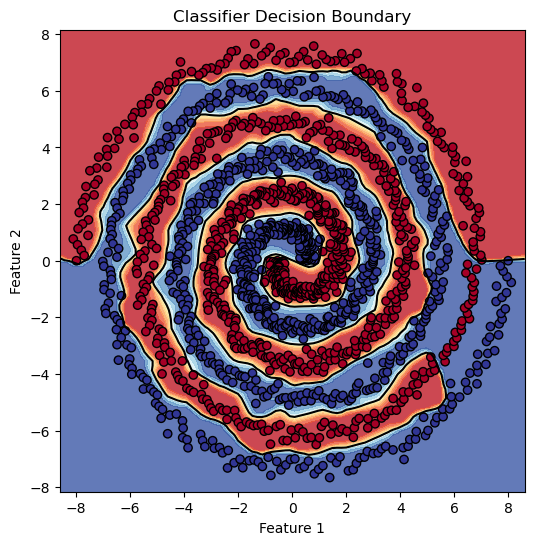

## Some Projects:
### Overtwisted Contact Structures and their Supporting Open Books on 3-Manifolds - March 2025
**[Interesting Low-dim Topology stuff that I have forgotten](4H_Project_FINAL.pdf)**

This is my Fourth year dissertation on the Giroux correspondance; a one-to-one correspondence between Contact structures and open book decompositions. There is something for all, topologists and geometrists alike!

### ON IDENTIFIABILITY IN TRANSFORMER NEURAL NETWORKS - April 2026
**[Transformers, GPT and more Buzzwords](On_Identifiability_In_Transformers_Notes.pdf)**

This was a group project written in conjuction with Logan, Finlo and Arden (Fellow CAM students). Cool topic but was quite a short project. It felt a bit rushed. I would love to revisit transformers.

### A Deep Learning Architecture for Inferring Physical Activity and Sleep from Wrist-Worn Actigraphy Data - August 2026
**[BiLSTMs, Time series and an Abstract that is too long](MSc_project_FS_FINAL.pdf)**

This is my project for the CAM MSc, completed over the summer. This was a thoroughly enjoyable project, exploring an exciting and vital application of deep learning, using the Uni's high performance compute facility for model training, allowing me to play around with GPUs and develop some HPC skills! I slightly furthered the current benchmark in PA inference on the CAPTURE-24 data, with the exception of a result by [Farrahi et al.](https://pubmed.ncbi.nlm.nih.gov/36724729/). However, my supervisor and I have our doubts on these results...Please feel free to reach out for any code etc.

---
Word of Warning: Read the above one at a time. Some may suffer from symptoms of [Whiplash](https://www.nhs.uk/conditions/whiplash/) going between the Topology and Deep Learning.
### DARTH Group website:
**[DARTH Group](https://www.darth-group.com/team)**
The research group my Master's project supervisor (Thanasis) runs! Check it out!

<!--  -->
